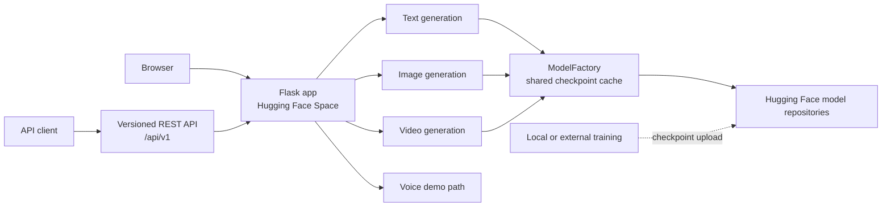
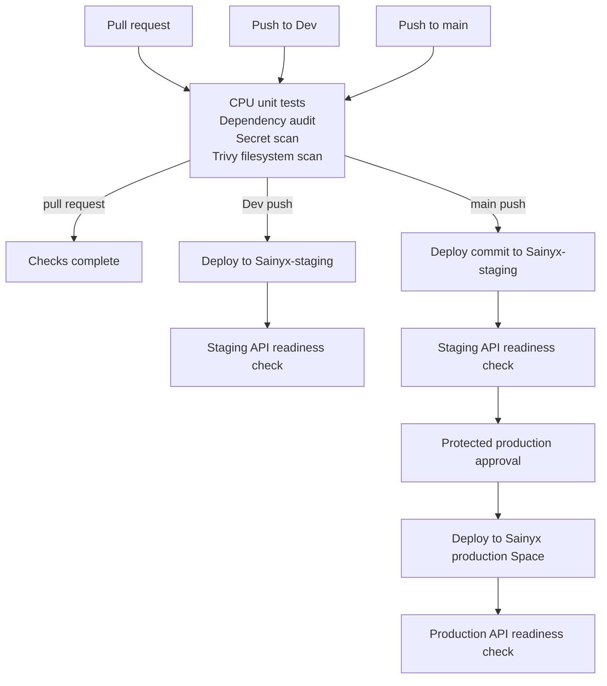

# Sainyx

Sainyx is an experimental, open-source generative AI application built with Flask and PyTorch. The repository includes text, image, video, and voice-demo generation paths; availability depends on the corresponding checkpoint and runtime dependencies.

[](https://github.com/Ssaiyajin/Sainyx/actions/workflows/staging.yml)

**Release status:** v1 released September 2026, ongoing model improvements.

## Current state and limitations

- The Flask interface and versioned REST API are implemented. Text generation is available when its checkpoint is reachable; image and video generation require their respective checkpoints.
- The image generator can use tag-conditioned prompts when a compatible checkpoint is loaded. It generates at low resolution, and output quality is experimental and may be inconsistent; upscaling does not recover detail absent from the source image.
- Text answers can be incoherent, factually incorrect, or incomplete. This is an experimental model, not a reliable source of information.
- Video generation is experimental and may be unavailable until a compatible checkpoint is present. The video model is not generally prompt-conditioned; synthetic training clips use pan-and-zoom transformations of still images.
- The voice path may use a speech model when installed and configured; otherwise it returns a synthetic tone. It must not be assumed to provide speech synthesis.
- Training-data provenance, third-party dataset rights, checkpoint licenses, and the exact parameter counts of published weights have not been independently verified. Do not assume the repository's MIT license grants rights to model weights or generated output.
- API keys are shared secrets; per-user identity, persistent jobs, and distributed rate limiting are not implemented. See the [API guide](docs/API.md).

## Try it

- [Hugging Face demo](https://huggingface.co/spaces/ssaiyajin/Sainyx)
- API base path: `/api/v1`; the machine-readable contract is served at `/api/v1/openapi.yaml`.
- The repository does not yet include a verified screenshot or recorded demo. Do not treat generated example assets as quality guarantees.

## Architecture

The Flask app serves the browser UI and versioned API. Its generation paths
share a model cache and load configured checkpoints from Hugging Face model
repositories when available. This diagram describes the code structure, not
the current availability or quality of deployed models.



### Pull request and release flow

Pull requests run the same tests and security checks without deployment. A
push to `Dev` deploys to the staging Space; a push to `main` stages the commit
first and waits for the protected production approval before promotion.
Post-deploy checks verify API readiness only and do not request model
generation.



See the [detailed architecture and checkpoint flow](docs/ARCHITECTURE.md) and
[deployment guide](docs/DEPLOYMENT.md).

## Deployment and operations

**Documentation status: complete for the current checked-in configuration.**
This does not assert that the Spaces or model checkpoints are currently
available.

The configured production runtime is the Hugging Face Space
[`ssaiyajin/Sainyx`](https://huggingface.co/spaces/ssaiyajin/Sainyx); the
staging Space is `ssaiyajin/Sainyx-staging`. CI deploys to staging, runs the
public API smoke test, and promotes the approved commit to the production
Space through the protected GitHub `production` Environment. A configured
Space URL does not by itself verify current availability.

This repository does not currently configure Prometheus/Grafana monitoring
or Kubernetes manifests/deployment validation. Its CI runs CPU unit/API tests
and its deployment workflow validates the staging and production APIs; it
does not deploy to a Kubernetes cluster. Do not describe those capabilities
as implemented for Sainyx.

## API

The API currently has typed `POST /chat`, `POST /image`, and `POST /video` routes, plus the generic `POST /generate` route. `GET /status` and `GET /openapi.yaml` are public; generation requires `X-API-Key`.

```bash
curl -X POST https://YOUR_HOST/api/v1/chat \
  -H "X-API-Key: $SAINYX_API_KEY" \
  -H "Content-Type: application/json" \
  -d '{"message":"Introduce Sainyx in one sentence.","max_tokens":40}'
```

```bash
curl -X POST https://YOUR_HOST/api/v1/image \
  -H "X-API-Key: $SAINYX_API_KEY" \
  -H "Content-Type: application/json" \
  -d '{"prompt":"gogeta blue","num_images":1,"seed":42}'
```

Flask does not generate an interactive API documentation page by itself. Sainyx serves an OpenAPI 3.1 YAML contract; examples, authentication setup, limits, and error responses are documented in the [API guide](docs/API.md).

## Run locally

Use Python 3.11 and install PyTorch/torchvision for your platform before the other requirements:

```powershell
git clone https://github.com/Ssaiyajin/Sainyx.git
cd Sainyx
py -3.11 -m venv .venv
.venv\Scripts\Activate.ps1
python -m pip install --upgrade pip
python -m pip install -r requirements-torch.txt --index-url https://download.pytorch.org/whl/cpu
python -m pip install -r requirements.txt
python app.py
```

The checked-in PyTorch pair is pinned. The command above selects CPU wheels; for CUDA or other platforms, use the matching official PyTorch wheel index while keeping the pinned pair.

The app listens on `http://localhost:7860`. Set `HF_TOKEN` only if a model repository requires authentication. The server-side API key is configured through `SAINYX_API_KEY`.

## Architecture and model documentation

- [Architecture diagram and checkpoint flow](docs/ARCHITECTURE.md)
- [Documentation index](docs/README.md)
- [Development and test guide](docs/DEVELOPMENT.md)
- [Space deployment and promotion guide](docs/DEPLOYMENT.md)
- [Text model card](docs/model-cards/text.md)
- [Image model card](docs/model-cards/image.md)
- [Video model card](docs/model-cards/video.md)
- [Combined model card](MODEL_CARD.md)

The cards document the evidence available in this repository. They do not claim that upstream training data or model weights have licenses that have not been verified. Copy the relevant card into the corresponding Hugging Face model repository after confirming its metadata and license.

## Development

- [Contributing guide](CONTRIBUTING.md)
- [Changelog](CHANGELOG.md)
- [Documentation index](docs/README.md)
- [Development and test guide](docs/DEVELOPMENT.md)
- [Pre-deployment validation workflow](.github/workflows/ci.yml)
- [Staging deployment workflow](.github/workflows/staging.yml)
- [Production deployment workflow](.github/workflows/deploy.yml)

Pull requests run CPU-capable unit tests, dependency auditing, secret scanning, and filesystem scanning. Deployments to Dev run the same checks before the staging Space smoke test. Production deployment requires approval through the protected GitHub `production` Environment; configure required reviewers in repository settings for that gate to be effective.

Configure the GitHub Actions secret `HF_TOKEN` for deployment and private staging readiness checks. Configure `SAINYX_API_KEY` separately in each Hugging Face Space for protected generation requests. The production Environment must have required reviewers configured; merely naming an Environment does not enable manual approval.

## License

Source code is licensed under the MIT License; see [LICENSE](LICENSE). Model weights and third-party training data may have separate terms and are not licensed by that statement.
