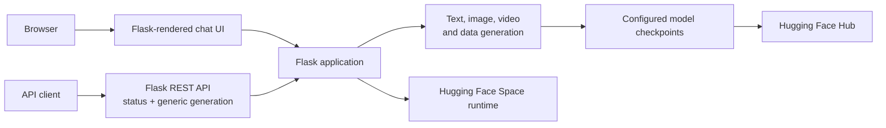
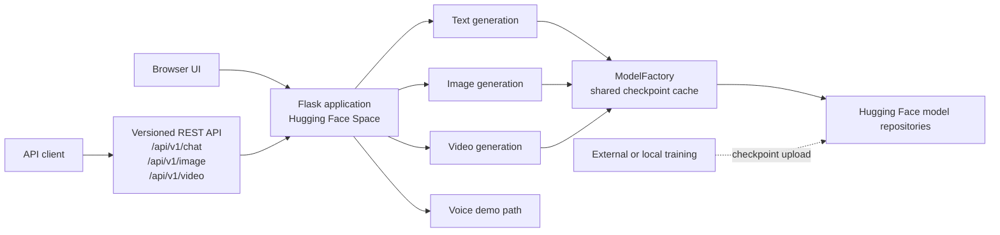
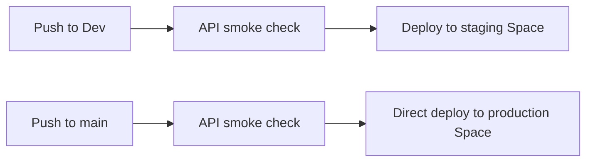
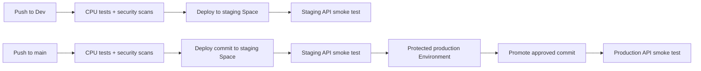

# Sainyx architecture and release flow

The diagrams distinguish the earlier web/API and deployment flow from the
current typed API and staging-to-production workflow. They describe the
repository configuration and do not guarantee that a Space or checkpoint is
currently available.

## Earlier application flow

The earlier interface and API were served by one Flask application. The
browser used the chat interface, while API clients called the generic
generation endpoints. Generation code loaded configured model checkpoints
from the Hugging Face Hub.

## Current application architecture

The Flask application serves the browser interface and versioned REST API.
Typed chat, image, and video routes and the generic generation route share
the application's registered generation code and `ModelFactory` checkpoint
cache. Checkpoints may be stored in different Hugging Face model repositories;
a configured repository ID does not prove that a checkpoint is published or
accessible.

Training scripts and dataset builders are present in the repository, but
training provenance, dataset rights, and published artifact contents must be
verified separately.

## Earlier release flow

Before the current promotion flow, a push to `Dev` ran the API smoke check
before deploying to the staging Space. A push to `main` likewise ran the
smoke check before deploying directly to the production Space. That flow
did not establish staging verification followed by a protected production
approval.

This is a historical workflow shape, not an assertion about past Space
availability.

## Current release flow

The `Dev` workflow runs CPU tests and security scans, deploys to the
staging Space, and checks its public API. The `main` workflow runs the checks,
deploys the commit to staging, and waits for the staging API smoke test before
requesting approval through the protected GitHub `production` Environment.
After approval it promotes the commit to production and runs a production API
smoke test. Required reviewers must be configured on that Environment for
the approval gate to be effective. Each workflow defines its checks as direct
jobs so the Actions graph shows concise job names; shared steps live in
composite actions. Pull requests run the separate validation workflow.

The workflows are [`staging.yml`](../.github/workflows/staging.yml),
[`deploy.yml`](../.github/workflows/deploy.yml), and the pull-request
validation workflow [`ci.yml`](../.github/workflows/ci.yml). Shared job steps
live in [composite actions](../.github/actions).

Sainyx does not currently configure Prometheus/Grafana monitoring or
Kubernetes manifests and deployment validation.
