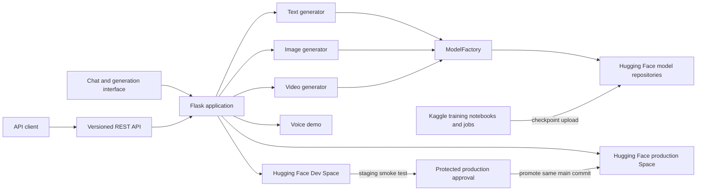

# Sainyx architecture

The application and API share generator implementations. `ModelFactory` downloads checkpoint files from Hugging Face Hub on demand and caches loaded models in process memory. Training runs are performed separately (historically in Kaggle); the repository does not contain the resulting checkpoints. The Dev Space and production Space are separate deployment targets. Production promotion is intended to occur only after a successful staging API smoke check and approval via GitHub's protected `production` Environment.

Checkpoint provenance, training snapshots, and authorization to redistribute upstream datasets still require verification; the diagram describes the code/configuration path, not a guarantee that every checkpoint is currently published or available.
